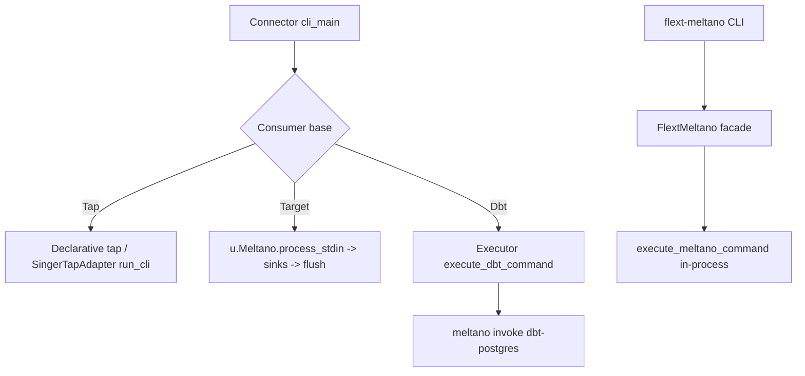

# flext-meltano Architecture

<!-- TOC START -->

- [🎯 Architectural Overview](#architectural-overview)
  - [Design Principles](#design-principles)
- [🏗️ Module Architecture](#module-architecture)
  - [Facade Families](#facade-families)
  - [Services](#services)
  - [Composition Root and Entry Points](#composition-root-and-entry-points)
- [🔄 Runtime Flows](#runtime-flows)
- [🛡️ Error Handling](#error-handling)
- [Related Documentation](#related-documentation)

<!-- TOC END -->

**Enterprise Meltano integration library architecture for the FLEXT ecosystem**

**Version**: 0.12.0-dev

---

## 🎯 Architectural Overview

flext-meltano is the foundation library for ELT operations in the FLEXT ecosystem.
It owns the Singer/dbt consumer bases that every `flext-tap-*`, `flext-target-*`
and `flext-dbt-*` connector extends (ADR-006), the in-process Meltano runtime
executor, and the `flext-meltano` CLI.

### **Design Principles**

1. **Type Safety First** - Pydantic v2 models through the `m` facade
1. **Railway-Oriented Programming** - every operation returns `r[T]`
1. **One owner per concern** - consumer bases own CLI dispatch and Singer/dbt
   mechanics; connectors implement one abstract hook
1. **Root-only imports** - consumers import from `flext_meltano`, never from
   `flext_meltano.services.*` or private modules
1. **singer_sdk ownership** - only flext-meltano imports `singer_sdk`

## 🏗️ Module Architecture

### **Facade Families**

```text
src/flext_meltano/
├── constants.py   + _constants/   # c.Meltano: enums and runtime constants
├── typings.py     + _typings/     # t.Meltano: type aliases
├── protocols.py   + _protocols/   # p.Meltano: executor, tap, sink, handler contracts
├── models.py      + _models/      # m.Meltano: Singer messages/catalog, configs, CLI inputs
├── utilities.py   + _utilities/   # u.Meltano: runtime command and Singer stdin helpers
├── _settings.py                   # FlextMeltanoSettings (settings.Meltano.*)
└── _config.py                     # FlextMeltanoConfig
```

The facade modules and package `__init__.py` files are generated by `make gen`.

### **Services**

```text
src/flext_meltano/services/
├── executor_base.py        # in-process Meltano command execution, project plugins
├── executor.py             # health and CLI readiness payloads
├── abstractions.py         # Meltano runtime abstraction (stream discovery, plugins)
├── meltano_plugin_discovery.py, project_service.py  # plugin discovery
├── library_runner.py       # dbt transformation runner
├── service.py              # specialized component factory (tap/target/dbt)
├── declarative_tap.py      # the only tap-side singer_sdk bridge (declarative taps)
├── singer_sdk.py           # adapter for an existing singer_sdk tap instance
├── singer_target.py        # target entry-point base
└── consumer_bases/         # Tap / Target / Dbt service bases for connectors
```

### **Composition Root and Entry Points**

- `api.py` — `FlextMeltano`, the MRO facade over the services, and the shared
  `meltano` instance.
- `service_bases.py` — root re-exports of the classes connectors build on.
- `cli.py` — the `flext-meltano` console script (`version`, `status`, `tap`,
  `target`, `dbt`, `plugin`, `pipeline`).
- `pipeline_mgr.py` — persisted pipeline definitions served by the `pipeline`
  CLI group.

## 🔄 Runtime Flows



## 🛡️ Error Handling

Every operation returns `r[T]`; failures carry the original error text. CLI
entry points translate a failed result into a non-zero exit code.

## Related Documentation

- [Getting Started](getting-started.md) - Installation and basic usage
- [API Reference](api-reference.md) - Public surface
- [Integration Patterns](guides/integration.md) - Connector patterns
- [Examples](https://github.com/flext-sh/flext/tree/0.12.0-dev/flext-meltano/examples/) -
  Working code examples
